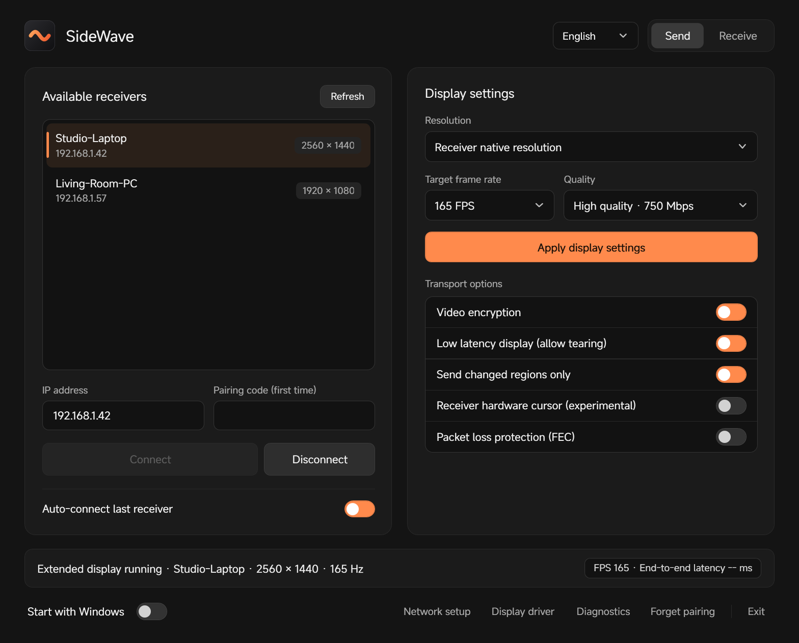
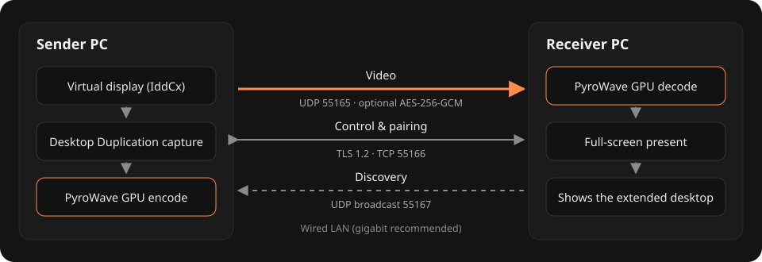
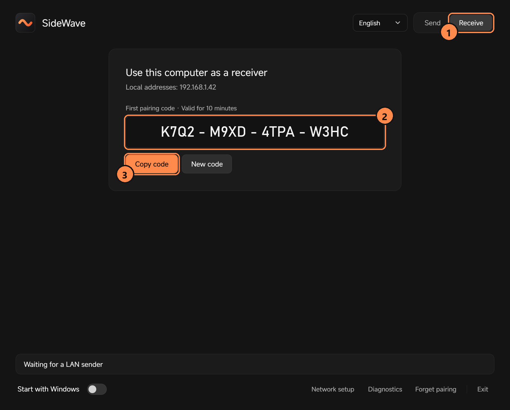
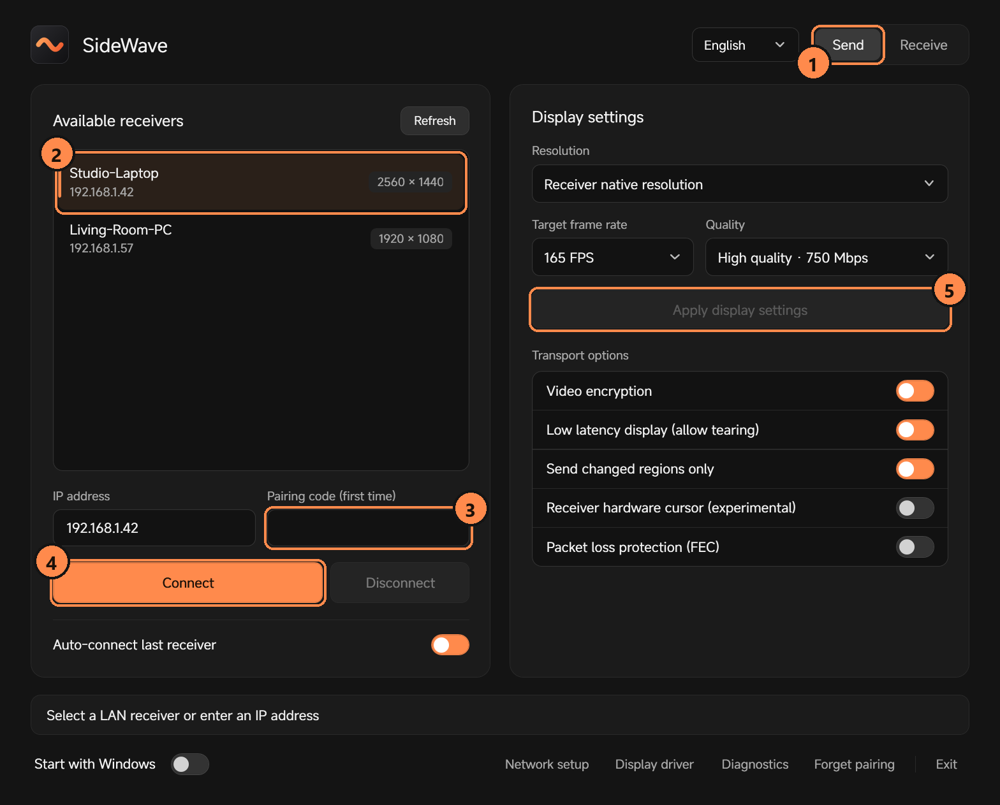

<p align="center"></p>

<h1 align="center">SideWave</h1>

<p align="center">Turn a second Windows PC into a low-latency extended display over your LAN.</p>

<p align="center"><b>English</b> · <a href="README.zh-CN.md">简体中文</a></p>

> **0.1 preview.** Tested PC-to-laptop at 1920×1080 and 2560×1440 from 60 to 240 FPS.
> Other GPU vendors, drivers and resolutions are still being validated.

<p align="center"></p>

## Highlights

- **A real extended desktop.** The sender adds a virtual monitor; Windows treats the receiver as one more screen.
- **GPU video path.** PyroWave wavelet encoding and decoding on the GPU, SDR 4:4:4 full range, 60 / 120 / 165 / 240 FPS.
- **Built for latency.** Captures desktop updates immediately, with optional changed-region frames, tearing-allowed presentation and a receiver hardware cursor.
- **Paired and private.** TLS 1.2 control channel, one-time 16-character pairing code, credentials protected with Windows DPAPI, optional AES-256-GCM video.
- **One portable app.** The same executable sends or receives; LAN discovery, tray icon, start with Windows, Chinese and English UI.

## How it works

<p align="center"></p>

## Requirements

- Windows 10 or 11 x64 on both PCs, with a GPU that supports Vulkan and D3D11.4 shared textures and fences.
- Both PCs on the same LAN segment with the Windows network profile set to **Private**. A wired gigabit link is recommended.
- The sender needs the signed virtual display driver; the app installs it for you.

## Quick start

1. Download the same release on both PCs, unzip it and run `PyroScreen.exe` (SideWave keeps its original executable name).
2. On each PC click **Network setup** once and approve the Windows prompt. This allows the app on Private networks only.
3. **On the receiver**, stay in Receive mode (the default on first launch).

   

   ① Receive mode ② the one-time pairing code, valid for 10 minutes ③ copy it if you want to paste it on the sender.

4. **On the sender**, switch to Send mode and click **Display driver** once to install the virtual display driver.

   

   ① Send mode ② pick the receiver, or type its IPv4 address ③ enter the pairing code (first connection only) ④ **Connect** ⑤ choose resolution, frame rate and quality, then **Apply display settings**.

5. A new display appears in Windows. Arrange it in **Settings › Display** and drag windows onto it.

Paired devices reconnect without a code. Closing the window keeps SideWave in the tray; **Exit** stops the video and removes the virtual display.

## Options

| Option | What it does | Default |
| --- | --- | --- |
| Quality | Encoded-data budget of 400 / 600 / 750 / 900 Mbps; capped to 90% of the slower network adapter | 600 Mbps |
| Video encryption | AES-256-GCM for video packets; off sends plaintext UDP with less overhead | Off |
| Low latency display | Presents without waiting for vertical sync; tearing is possible | Off |
| Send changed regions only | Encodes only the part of the desktop that changed; full-screen motion still sends whole frames | Off |
| Receiver hardware cursor | Draws the pointer with the receiver's own cursor instead of inside the video (experimental) | Off |
| Packet loss protection (FEC) | Adds one parity fragment per packet to recover a single lost fragment | Off |

## Network ports

| Purpose | Protocol / port |
| --- | --- |
| Discovery | UDP 55167 (broadcast) |
| Pairing, control, statistics, clock sync | TLS over TCP 55166 |
| Video | UDP 55165 |

**Network setup** only creates firewall rules for this executable, limited to Private networks and the local subnet. SideWave sends no telemetry and does not check for updates.

## Known limitations

- Preview software. Not yet validated: other GPU vendors, HDR, rotated displays, several receivers at once, audio. The receiver uses its primary screen.
- Discovery needs both PCs in one broadcast domain. Guest Wi-Fi isolation, VLANs or third-party firewalls can hide the receiver; enter its IP address instead.
- Settings and pairings live in `%LOCALAPPDATA%\PyroScreen`. Never share that folder: it identifies your paired devices.
- If the link drops during high-bitrate streaming, update the network adapter driver or choose a lower quality budget.

## Build from source

Requirements: Visual Studio 2022 with Desktop development with C++, Windows SDK, Git, CMake 3.27 or later (the Visual Studio "C++ CMake tools" component works) and .NET Framework 4.8.

```powershell
powershell.exe -NoProfile -ExecutionPolicy Bypass -File .\build.ps1
```

`build.ps1` fetches the pinned upstream PyroWave sources and builds everything into `build\`. Upstream paths are deep, so clone into a short path such as `C:\src\sidewave`, or run `git config --global core.longpaths true`. `tools\package.ps1` creates the release and source zips; `tests\build_tests.ps1` builds the protocol and two-machine test tools.

## Documentation

- [Technical notes](docs/technical-notes.md): runtime behavior, bandwidth control, FEC and latency metrics (Chinese)
- [Protocol](docs/protocol.md) · [Local control API](docs/local-control.md) · [Constant frame cadence](docs/constant-frame-cadence.md) · [Changed-region frames](docs/partial-frames.md) · [Transports](docs/transports.md)

## License

SideWave is released under the [MIT License](LICENSE). PyroWave, Granite, Vulkan headers, Volk and the virtual display driver keep their own copyrights and licenses; see `third_party` and the `licenses` folder in the release. The virtual display driver is the officially signed VirtualDrivers build. Its installer keeps the Windows publisher prompt and never changes root certificates, TrustedPublisher or test-signing settings.
