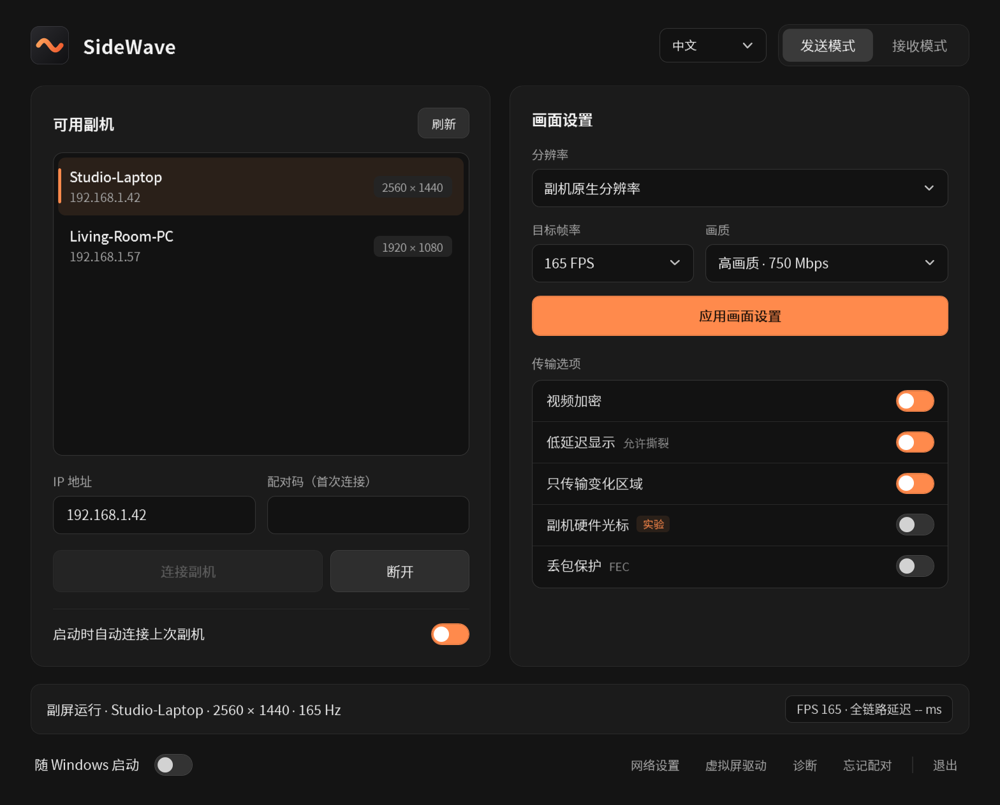
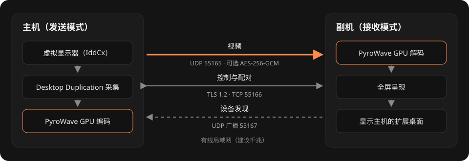
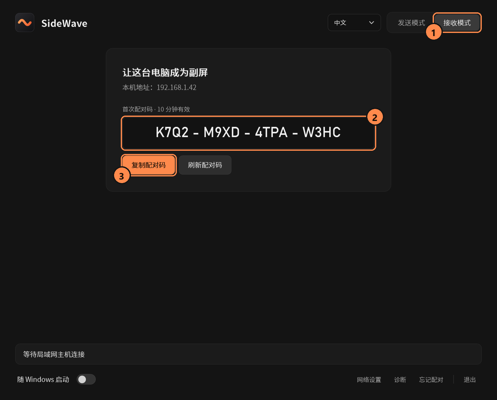
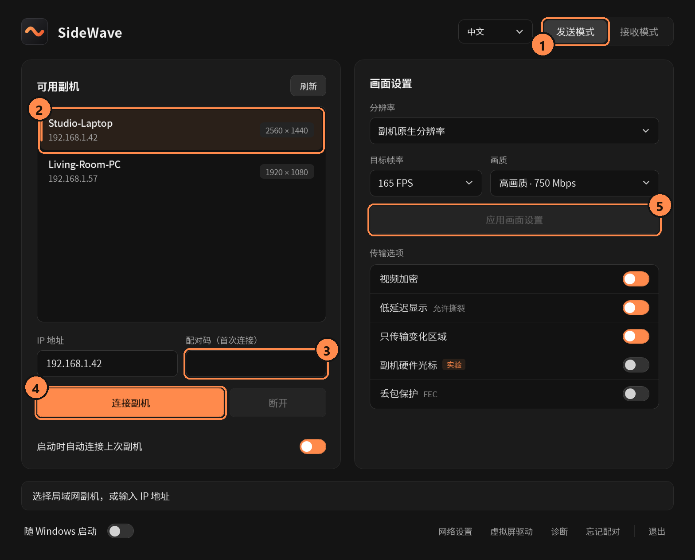

<p align="center"></p>

<h1 align="center">SideWave</h1>

<p align="center">把另一台 Windows 电脑变成局域网低延迟扩展副屏。</p>

<p align="center"><a href="README.md">English</a> · <b>简体中文</b></p>

> **0.1 预览版。** 已完成台式机到笔记本的双机测试，覆盖 1920×1080、2560×1440 下 60–240 FPS。
> 其他厂商 GPU、驱动和分辨率仍在验证中。

<p align="center"></p>

## 特点

- **真正的扩展桌面**：主机创建一块虚拟显示器，Windows 把副机当成多出来的一块屏。
- **全程 GPU 视频链路**：PyroWave 小波编解码，SDR 4:4:4 全范围，支持 60 / 120 / 165 / 240 FPS。
- **为低延迟而做**：桌面一有更新就立即采集；可选只传变化区域、允许撕裂的呈现、副机硬件光标。
- **配对安全**：TLS 1.2 控制通道，16 位一次性配对码，凭据由 Windows DPAPI 加密，视频可选 AES-256-GCM。
- **一个程序搞定**：同一个 EXE 既能发送也能接收；局域网自动发现、托盘常驻、随 Windows 启动，中英文界面。

## 工作原理

<p align="center"></p>

## 运行要求

- 两台电脑都是 Windows 10 / 11 x64，GPU 支持 Vulkan 和 D3D11.4 共享纹理与栅栏。
- 两台电脑在同一个局域网网段，Windows 网络类型设为**专用**。建议使用有线千兆网络。
- 主机需要已签名的虚拟显示驱动，软件内可一键安装。

## 快速上手

1. 两台电脑下载同一个发行包，解压后运行 `PyroScreen.exe`（SideWave 沿用了原来的程序文件名）。
2. 两台电脑各点一次 **网络设置**，在 Windows 提示中确认。这只会允许软件在专用网络中通信。
3. **副机**：保持接收模式（首次启动默认就是接收模式）。

   

   ① 接收模式 ② 一次性配对码，10 分钟内有效 ③ 需要时复制配对码。

4. **主机**：切到发送模式，首次使用点一次 **虚拟屏驱动** 安装驱动。

   

   ① 发送模式 ② 选择副机，或手动输入它的 IPv4 地址 ③ 输入配对码（仅首次连接需要）④ **连接副机** ⑤ 选择分辨率、帧率和画质，点 **应用画面设置**。

5. Windows 中会出现一块新显示器。在 **设置 › 显示** 里调整排列，把窗口拖过去即可。

已配对的设备再次连接不需要配对码。关闭窗口后软件留在托盘；点 **退出** 会停止视频并移除虚拟屏。

## 选项说明

| 选项 | 作用 | 默认 |
| --- | --- | --- |
| 画质 | 编码数据预算 400 / 600 / 750 / 900 Mbps；不超过两端较慢网卡速率的 90% | 600 Mbps |
| 视频加密 | 视频包使用 AES-256-GCM；关闭时为明文 UDP，开销更小 | 关 |
| 低延迟显示（允许撕裂） | 不等待垂直同步直接呈现，可能出现画面撕裂 | 关 |
| 只传输变化区域 | 只编码桌面变化的部分；全屏运动时仍发送整帧 | 关 |
| 副机硬件光标（实验） | 用副机自己的光标显示鼠标，不再合成进视频 | 关 |
| 丢包保护（FEC） | 每个数据包多发一片校验，可恢复一片丢失 | 关 |

## 网络端口

| 用途 | 协议 / 端口 |
| --- | --- |
| 设备发现 | UDP 55167（广播） |
| 配对 / 控制 / 统计 / 校时 | TLS over TCP 55166 |
| 视频 | UDP 55165 |

**网络设置** 只为本程序创建防火墙规则，并限定为专用网络和本地子网。SideWave 不上传任何数据，也不检查更新。

## 已知限制

- 预览版。尚未验证：其他厂商 GPU、HDR、旋转屏、同时连接多台副机、音频。副机使用其主屏显示。
- 自动发现要求两台电脑在同一广播域。访客 Wi-Fi 隔离、不同 VLAN 或第三方防火墙可能导致搜不到副机，此时直接输入 IP。
- 配置和配对信息保存在 `%LOCALAPPDATA%\PyroScreen`，其中包含已配对设备的身份，不要分享这个目录。
- 如果高码率串流时网络断开，请更新网卡驱动或调低画质预算。

## 从源码构建

需要 Visual Studio 2022（"使用 C++ 的桌面开发"）、Windows SDK、Git、CMake 3.27 或更高版本（可用 Visual Studio 的"C++ CMake 工具"组件）以及 .NET Framework 4.8。

```powershell
powershell.exe -NoProfile -ExecutionPolicy Bypass -File .\build.ps1
```

`build.ps1` 会获取固定版本的上游 PyroWave 源码，并全部构建到 `build\` 目录。上游源码目录较深，请克隆到较短路径（例如 `C:\src\sidewave`），或执行 `git config --global core.longpaths true`。`tools\package.ps1` 生成发行包和源码包；`tests\build_tests.ps1` 构建协议测试和双机测试工具。

## 更多文档

- [技术说明](docs/technical-notes.md)：运行行为、带宽控制、丢包保护和延迟指标
- [协议](docs/protocol.md) · [本地控制接口](docs/local-control.md) · [固定帧率说明](docs/constant-frame-cadence.md) · [只传输变化区域](docs/partial-frames.md) · [传输方案](docs/transports.md)

## 许可证

SideWave 采用 [MIT 许可证](LICENSE)。PyroWave、Granite、Vulkan headers、Volk、内置的思源黑体 Noto Sans SC（SIL OFL 1.1）和虚拟显示驱动保留各自的版权和许可证，见 `third_party` 及发行包中的 `licenses` 目录。虚拟显示驱动使用 VirtualDrivers 官方签名版本，安装时保留 Windows 发布者确认，不会修改根证书、TrustedPublisher 或测试签名设置。
